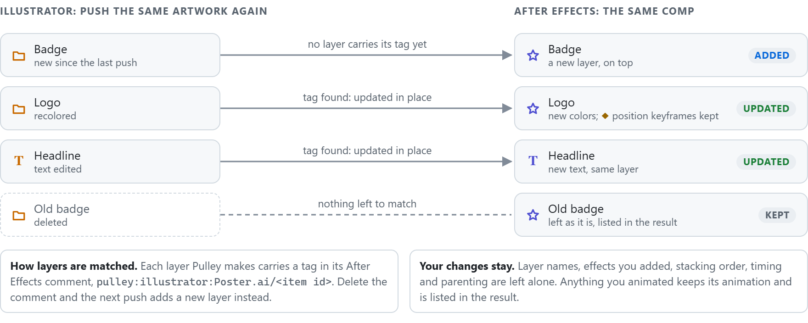

# Pulley architecture

How Pulley is built, as of 0.1.0. Facts marked *measured* or *verified* come from the tests and
probes described in [VERIFICATION.md](VERIFICATION.md); everything else describes the code.

## Goal

Move vector artwork from Illustrator and Figma into After Effects as native, editable shape and
text layers. All parsing, geometry, color and validation logic lives in one Rust library,
`pulley-core`, which runs natively in the bridge and as WebAssembly in every client. The Adobe
apps and Figma only read their own data and apply precomputed values. Everything runs locally.

## Components

<picture>
  <source media="(prefers-color-scheme: dark)" srcset="images/components-dark.png">
  
</picture>

### Rust workspace

| Crate | Path | Role |
|---|---|---|
| `pulley-core` | `core/pulley-core` | Scene types and validation with hard limits; Illustrator capture → scene; SVG document and path parsing (M L H V C S Q T A Z, absolute and relative; quadratics and arcs become cubics); Figma nodes → scene; shape builders (rounded rectangles, ellipses and arcs, polygons, stars); gradient geometry; AE plan generation; `.ffx` gradient presets; bridge protocol; fuzzing entry points. `forbid(unsafe_code)`, no I/O. |
| `pulley-wasm` | `core/pulley-wasm` | wasm-bindgen exports, each `fn(&str…) -> Result<String, JsValue>`: `version`, `illustratorToScene`, `figmaToScene`, `checkScene`, `sceneToPlan`, `checkMessage`. Separate crate because the generated glue contains `unsafe`. |
| `pulley-bridge` | `bridge` | Tray app and WebSocket server. Our code is `forbid(unsafe_code)`. |
| `xtask` | `xtask` | `cargo xtask icons [--check]`: renders and validates every icon output from the registry. |
| `pulley-fuzz` | `fuzz` | cargo-fuzz targets (own workspace, nightly). |

### Data formats

| Data | Produced by | Consumed by | Leaves its component? |
|---|---|---|---|
| Illustrator capture (`pulley-ai-capture` v2 JSON, plus an SVG when copies were needed) | `capture.jsx` | pulley-core in the same extension | No |
| Figma nodes (`pulley-figma-nodes` v1 JSON) | plugin main thread (`read.ts`) | pulley-core in the plugin UI | No |
| **pulley-scene v2** | pulley-core in a client | the bridge (validates), the AE extension | **Yes: the only format between components** |
| AE plan (line-based text) | pulley-core in the AE extension | `apply.jsx` | No |
| `.ffx` gradient presets | pulley-core in the AE extension | `apply.jsx` (`applyPreset`) | No |

### The CEP extensions

Each Adobe app gets two extensions from one bundle: a **hidden background extension** that
starts with the app (*verified* in AE 25.5 and Illustrator 29.5: `Custom` type, `AutoVisible`
false, StartOn `ApplicationActivate`/`ApplicationInitialized`) and owns the WebSocket, the
WebAssembly module and every ExtendScript call; and the **visible panel**, which only shows state
and sends requests over application-scope CSEvents. Push and Pull therefore work with the panels
closed. If the panel finds no background extension, it starts it.

- No CSInterface.js: `panels/shared/js/cep.js` is a small wrapper over `window.__adobe_cep__`.
  Its `call(fn, args)` checks the function name against an identifier pattern and passes each
  argument as an escaped string literal.
- WebAssembly is inlined as base64 and compiled asynchronously (Chromium refuses synchronous
  compiles over 4 KB on the main thread). Size: about 650 KB after `wasm-opt -Oz`, 260 KB gzipped.
- Node.js stays off; files go through `window.cep.fs` into `%APPDATA%\Pulley` (or
  `~/Library/Application Support/Pulley`).
- The only process launch: the bridge from its install location, without a shell or arguments.

## After Effects import

<picture>
  <source media="(prefers-color-scheme: dark)" srcset="images/ae-import-dark.png">
  
</picture>

1. The background extension receives a scene (bridge push, answer to a pull, or a `.pulley`
   file). pulley-core validates it again and builds the **plan** with the panel's options: one
   layer per item / merge / precompose, centered or original position, track mattes or masks.
   All math happens here: anchor points at each layer's visual center, comp placement, tangents
   relative to vertices, gradient points and highlight, stroke-alignment emulation, layer
   splitting for groups that contain text or clipping.
2. The plan goes to `<config>/tmp/plan-<id>.txt`; each gradient's preset to
   `<config>/tmp/grad-<id>-<n>.ffx`. *Measured* in milestone 1: a temp file is faster than passing
   text through `evalScript` (47 ms against 86 ms for 431 KB).
3. One `evalScript` call runs `pulleyApplyPlan(planPath, cancelPath, ffxPrefix)` in the fixed
   interpreter (`panels/ae/jsx/apply.jsx`):
   - `app.beginUndoGroup("Pulley Import")` … `endUndoGroup()`: **one undo step** (*verified*:
     one Undo removes everything, including a new comp and the gradient presets).
   - Each plan line maps to a few DOM calls. Strings are percent-encoded and decoded with
     `decodeURIComponent`; nothing is evaluated.
   - Every 50 operations it reports progress (a `CSXSEvent` the extension forwards to the bridge) and
     checks for a cancel file; on cancel it removes what it built.
   - Large plans (over 200 lines) open a 4×4 placeholder comp in the viewer while building and
     remove it at the end: an open comp viewer makes building about 10× slower (*measured*).
   - Each group is built completely before the next sibling is added, because adding a sibling
     invalidates earlier property references in AE.
4. **Gradient colors** can't be set by script (`ADBE Vector Grad Colors` has no value type in AE
   25.5, *verified*). After building, the interpreter applies one generated preset per gradient:
   it selects the gradient fill or stroke property, calls `layer.applyPreset(file)`, deselects,
   and finally restores the user's layer selection. The preset is a RIFX `FaFX` file written by
   `pulley-core/src/ffx.rs`, following the structure of AE 2025's own presets: a property path to
   `ADBE Vector Grad Colors`, and a `GCst` value whose `GCky` chunk holds the `prop.map` XML with
   the color and alpha stops. Two details matter (*verified*): names must use the current
   `Utf8`-prefixed encoding, otherwise AE ignores the preset silently, and the XML must not end
   with a zero byte, otherwise AE shows "Error parsing properties list from memory (13)". AE
   applies the preset to the selected property whatever the path's indices say.
5. The result (counts, warnings, missing fonts, timings, gradients applied) goes to the panel and
   back through the bridge to the sender. Temp files are deleted.

### Plan format

One operation per line; the full list is at the top of
[`aeplan.rs`](../core/pulley-core/src/aeplan.rs): `COMP`, `PRE`/`PREEND` (precomps), `LS` (shape
layer), `G`/`E` (groups), `P` (path), `F`/`S` (solid fill/stroke), `GF`/`GS` (gradient
fill/stroke), `O` (Offset Paths), `LT`/`TX`/`R`/`TEND` (text layer, content, styled runs),
`FB`/`FBEND` (outline fallback used only when a font is missing), `MATTE`, `MASK`, `LEND`, `END`.
Fields are numbers or percent-encoded strings. The format exists because ExtendScript has no
native JSON (*verified*), a JSON parser in ExtendScript took 6.2 s for a 431 KB scene, and large
arrays are pathologically slow there (51 s to walk one 60,000-element array); one split per line
keeps every array small.

### Re-push: updating earlier layers

<picture>
  <source media="(prefers-color-scheme: dark)" srcset="images/repush-dark.png">
  
</picture>

Every top-level layer Pulley creates gets a tag in its comment:
`pulley:<source app>:<document name>/<item id>` (percent-encoded). The plan says which item
each layer comes from (`DOC` and `ID` lines, see `aeplan.rs`). When *Update layers from
earlier pushes* is on, the interpreter first collects the target comp's tagged layers for this
document, then for each top-level layer in the plan:

- **No tagged layer:** create it, as before, and tag it.
- **Tagged layer found:** update it in place. Each transform property is set unless it is
  animated (keyframes or an expression). Shape contents are rebuilt unless any of them is
  animated; masks are replaced unless animated; text is restyled unless the text properties are
  animated; a precomp's contents are rebuilt inside the same comp item unless anything inside is
  animated. Names, effects, stacking order, timing and parenting are left alone. Everything kept
  is listed in the result.
- **Tagged layers not in this push** (item deleted or hidden in the source) are kept and listed.

Items with ids that aren't stable are never tagged (Illustrator items without a uuid), so they
can't be matched by mistake. Illustrator uuids survive closing, reopening and *Save As*
(*verified*, Part 1 of VERIFICATION.md); Figma node ids are stable by design. It is all inside
the import's single undo group.

### Text and fonts

- Fonts are found with `app.fonts.getFontsByPostScriptName` (Illustrator gives PostScript names),
  then `getFontsByFamilyNameAndStyleName` (Figma gives family and style only).
- Runs are styled with `TextDocument.characterRange(start, end)` (font, size, color, tracking).
  Area text becomes box text.
- A missing font: if the scene carries outlines for that text (Figma always; Illustrator with
  *Include text outlines*), the plan's `FB` block builds them as a shape layer instead; otherwise
  AE substitutes a font and the result lists the font as missing.

### Clipping and strokes

- Clipping groups become track mattes (default; the matte layer is hidden) or layer masks.
  Nested clipping becomes a track matte on a precomp.
- AE strokes are always centered. Inside/outside strokes on closed paths are emulated in a
  sub-group with Offset Paths at ∓w/2 and the stroke at full width, with a warning.
- Dashes: up to 3 dash/gap pairs plus offset; miter limit only when the join is miter (AE hides
  it otherwise).

### Images

- **Figma:** the plugin reads each visible image fill's settings and, for the selection's distinct
  images, the original file bytes (`getImageByHash(...).getBytesAsync()`, 40 MB per send). The
  core identifies each by SHA-256, checks its format and size, and turns each image fill into an
  `image` item cut to the node's shape: FILL and FIT scale about the box center (with the fill's
  quarter-turn rotation), CROP inverts Figma's `imageTransform` over the node box, TILE places one
  tile. Fills below and above an image fill, and the strokes, become shapes below and above it in
  a group carrying the node's opacity, blend mode and effects.
- **Illustrator:** the capture records each linked image's path, file size, box and matrix; the
  panel reads the files (`cep.fs`, base64) and passes them to the core. Pixels map into the item's
  box and through its matrix; Illustrator's matrix needs its off-diagonal terms negated for this,
  and an embedded raster's box is mirrored, so the core tries those conventions and keeps the one
  that reproduces the item's own `geometricBounds` (verified with placed PNGs moved, scaled,
  rotated and mirrored in Illustrator 29.5, then read back from After Effects' render).
- **After Effects:** the panel writes each image to `<config>/media/<sha256>.<ext>` (skipped when
  already there) and the plan's `IMG` line imports it (once per project: footage already in the
  project for that file is reused) into a "Pulley images" folder, adds a footage layer with its
  anchor at the image center, and the image's clip becomes masks in the layer's own pixel space.
  Effects on an image are converted into that space too. On re-push the layer's source is
  replaced if the image changed.

### Shadows and blurs

- Figma drop shadows and layer blurs travel in the scene as `effects` with blur sizes as a
  Gaussian standard deviation (see [SCENE.md](../schema/SCENE.md)). The plan turns them into `FX`
  lines with After Effects values: Drop Shadow direction (clockwise from up), distance and
  softness, Gaussian Blur blurriness, from measured relations
  ([VERIFICATION.md](VERIFICATION.md#effects-calibration)). Effects draw in layer space, so for a
  rotated or scaled text layer the plan turns the shadow back by the layer's rotation and scale.
- Placement: an item with effects always gets its own layer. A shape or a shape-only group puts
  them on its shape layer; a group whose children need several layers, or a clip group shown with
  a track matte (the matte would cut the shadow off), is built in a precomp and the effects go on
  the precomp layer; with layer masks a clip group stays one layer (masks apply before effects).
- The interpreter names them "Pulley Drop Shadow", "Pulley Drop Shadow 2", "Pulley Blur". On
  re-push it updates those in place (animated parameters kept), adds missing ones, and removes
  the ones the source no longer has unless they are animated. Effects with other names (the
  user's own) are never touched.

### Performance

*Measured* (AE 25.5, i9-13900H, 500 paths × 20 points):

| Mode | Time |
|---|---|
| One layer per item (500 layers) | 3.2 s (9.0–15.7 s before templates) |
| Merge (one shape layer, 500 groups) | 3.9–5.7 s |

The time is spent in AE's scripting DOM. Measured with
[`tests/ae/layer-bench.jsx`](../tests/ae/layer-bench.jsx), 200 shape layers into a comp that is
open on screen: `layers.addShape()` 37 ms per layer with the viewer swapped out (63–175 ms with the
comp on screen); duplicating one empty template shape layer and moving the copy to the top, 8 ms.
So the interpreter keeps one empty template shape layer per comp it builds in, makes every new
shape layer from it, and removes the templates at the end (all inside the import's undo group);
and it shows a 4 × 4 placeholder comp while it builds any plan that adds 8 or more layers (or has
more than 200 lines), reopening your comp afterwards. Building in a never-opened temporary comp
and copying the layers in (`copyToComp`) was slower (29 ms per layer).

## Bridge

<picture>
  <source media="(prefers-color-scheme: dark)" srcset="images/connect-dark.png">
  
</picture>

- **Runtime:** tokio on worker threads; the tray (`tray-icon`, `muda`) on the main thread
  through `tao`, as macOS requires. `--headless` runs without the tray (tests).
- **Bind:** `127.0.0.1:<port>`, default 47290 (`settings.json` can change it; the Figma
  manifest lists 47290 only).
- **Handshake:** `Host` must be `127.0.0.1:<port>` or `localhost:<port>`; `Origin` must be
  `file://` (CEP, *verified* on Windows) or `null` (Figma). Anything else is refused before the
  upgrade. Then `hello` within 5 seconds with the right credential for that origin and role:
  the per-start session token (`<config>/session.token`) for the Adobe extensions, a pairing key
  for Figma. Pairing: *Pair Figma plugin…* shows an 8-character code for 2 minutes and copies it
  to the clipboard (`arboard`), so it can be pasted into the plugin;
  `pair_request` with the code returns a new 256-bit key, stored in `settings.json` (up to 16
  kept) and in the plugin's `figma.clientStorage`.
- **Protocol** (JSON text frames, `{protocol: 1, id, type, …}`, unknown fields rejected,
  [`protocol.rs`](../core/pulley-core/src/protocol.rs)): `hello`, `welcome`, `pair_request`,
  `paired`, `status`, `push_scene`, `scene_chunk`, `pull_request`, `pull_error`,
  `import_result`, `progress`, `cancel`, `activity`, `ping`/`pong`, `error`. Large scenes
  travel as ordered `scene_chunk` messages (at most 512 KB each) and are reassembled with a 64 MB cap. Errors carry a
  stable code, a plain message and a hint about what to do.
- **Routing:** pushes go to the After Effects instance used most recently (each extension sends
  `activity` when its app becomes active). Pulls from After Effects go to the source used most
  recently: Illustrator, or the Figma plugin (which sends `activity` on selection changes and
  clicks). Results, progress and cancels follow the transfer.
- **Validation:** every scene is parsed and validated natively before it is forwarded.
- **Logs:** `tracing` + `tracing-appender`, a file per day, 7 kept, under `<config>/logs`.
- **Launch at login:** tray option (`auto-launch`). Idle: about 13 MB of memory and no CPU
  (*measured* on Windows).

## Illustrator capture

`panels/illustrator/jsx/capture.jsx` walks the selection with **read-only DOM access**. For each
item it records name, uuid, opacity, blend mode, clipping, fill and stroke (spot and global
colors resolved; CMYK and gray converted with `app.convertSampleColor`), gradient stops and
geometry, path points with handles, and text (characters, runs merged from per-character
attributes, frame type, matrix).

Copies are needed only for things the DOM can't give directly: **text outlines** (when *Include
text outlines* is on), **symbol** artwork, **paths over 1,000 points** (reading those point by
point is slow), **effects** and **embedded images**. These items are duplicated into one
temporary document sized to the artboard, with a reference square for alignment; it is closed
without saving.

- Effects and embedded images first. An item whose appearance reaches beyond its geometry (a
  path drawing outside its stroke, a group outside all its children, a text frame outside its
  text) is expanded there (Object > Expand Appearance) and the result read like a selection: its
  shapes and live text as usual, and each embedded picture saved as a transparent PNG
  (`Document.imageCapture`, alone on a layer with everything else hidden, at 72 / the picture's
  scale ppi, at full opacity: the item's opacity travels as a layer property). Expanded items
  get ids derived from the original's uuid (`<uuid>x<index>`), so re-push finds their layers.
  An expansion that adds nothing (no picture, and text or a group expanded into itself, as when
  area text's letters reach past its frame) is dropped. Embedded images of the selection are
  saved the same way. The panel reads the PNGs and deletes them.
- Then the outline, symbol and long-path copies are exported to SVG in Pulley's temp folder;
  pulley-core parses it and matches its elements to the captured items by id. (The SVG exporter
  writes rasterized effects of outlined text as extra PNGs; the capture deletes them.)

Measured (Illustrator 29.5): copying an item with effects into the temporary document takes about
0.45 s, Expand Appearance about 0.1 s, saving a picture about 0.2 s; moving the temporary view
away or switching it to Outline mode doesn't change the copy time (and doesn't change the
pictures). Setting a copy's position, which always came out unchanged, cost 0.125 s, so it is
set only when it differs.

Why DOM first: in milestone 1, reading every point of 500 script-created paths took 78.6 s, which
suggested SVG export. Measured on documents opened from disk (like real ones), reading 100 paths ×
20 points takes 31 ms, while copying items into another document costs about 75–150 ms each.
Details: [ILLUSTRATOR_READ_BENCHMARK.md](ILLUSTRATOR_READ_BENCHMARK.md).

Other details: gradient endpoints come from `origin`, `angle`, `length` and the item `matrix`;
Large Canvas documents are scaled by `scaleFactor`; document-level collections are never trusted
(they can read 0 right after changes); the user's document is never exported (`exportFile`
marks it saved).

## Figma plugin

- **Main thread** (`figma-plugin/src/code.ts`, `read.ts`): `documentAccess: "dynamic-page"`.
  Reads the selection into `pulley-figma-nodes` v1: transforms (`absoluteTransform`), fills and
  strokes with gradient transforms, stroke settings (per-side weights become the largest), shape
  parameters (rectangle radii, ellipse arc data, polygon and star counts), `vectorPaths` for
  vectors, `fillGeometry` for boolean operations and text, styled text segments, effects (drop
  shadow and layer blur values; other effects by type only, to report them), masks and clipping. It never creates, changes or flattens
  nodes. Limits: 100,000 nodes, depth 48. It also stores the pairing key in
  `figma.clientStorage`. It has no network access.
- **UI** (`ui.ts`, built into one `dist/ui.html` with the WebAssembly core and the shared bridge
  client inlined): converts with `figmaToScene`, sends over `ws://localhost:47290`, shows pairing,
  progress and results, answers pulls, and offers *Save .pulley file* (a download of the scene).
- **Manifest:** `networkAccess.allowedDomains` = `ws://localhost:47290`, with a `reasoning`
  string, as Figma requires for local addresses in published plugins. Figma rejects IP addresses
  in that list ("must be a valid URL"), so the plugin connects by name; `localhost` resolves to
  the 127.0.0.1 the bridge listens on.
- **Conversion** (`pulley-core/src/figma.rs`): shapes are rebuilt from their parameters so
  strokes stay editable center lines; gradient handles are `inverse(gradientTransform)` applied
  to (0, .5), (1, .5) and (0, 1) of the node box.

## Icons

Every icon comes from one registry (`assets/icons/icons.json`, 46 slots) and its master SVGs;
`cargo xtask icons` renders the PNG, ICO and ICNS outputs and the UI icon bundle, and
`--check` fails if any output is missing, stale or wrong. Current icons are placeholders.
See [ICONS.md](ICONS.md) and [ICON_HANDOFF.md](ICON_HANDOFF.md).

## Security

Summary of [SECURITY.md](../SECURITY.md): loopback only; Host and Origin checks; session token or
pairing key; strict parsing with hard limits, checked in the bridge and again in After Effects;
fuzzing; no source code built from data, no `eval`, no shell; documents never modified.

## Open risks

- **CEP's end:** Adobe will disable CEP by default in December 2028 and remove it in December
  2029; AE's UXP is in beta. Keeping all logic in Rust keeps the port to UXP thin.
- **2026 versions:** community reports of signature checks despite PlayerDebugMode (AE 26.3,
  Windows) and "Unsupported Manifest version" (macOS); AE 26.0 added gradient Scale/Rotation,
  which may change how presets apply. Untested here.
- **Figma review** may reject plugins that need a local app; use development or private
  distribution.
- **macOS:** the bridge builds and its tests pass on macOS in CI, but Pulley has not been run there with the apps.
